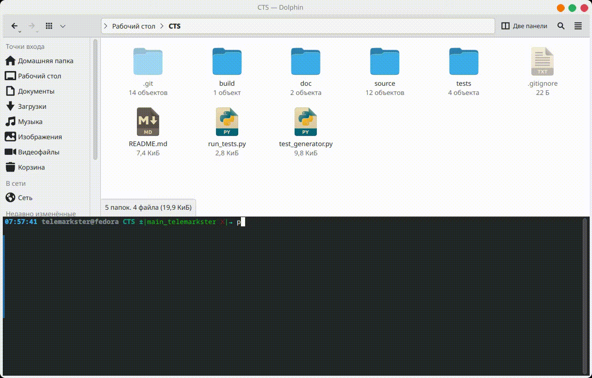

# CTS — синтез дерева синхронизации (MMM)

Инструмент **Clock Tree Synthesis**: по JSON-описанию кристалла строит дерево тактовой сети методом **MMM (Method of Means and Medians)**, считает задержки, выравнивает skew (wire snaking) и сохраняет отчёт с топологией.

## Назначение

Компилятор принимает источник такта, набор потребителей (sinks), библиотеку буферов и модель провода. Дальше:

1. читает и проверяет входной JSON;
2. рекурсивно разбивает sinks по медиане и вставляет буферы;
3. считает задержки (Elmore или линейная модель);
4. при необходимости удлиняет быстрые ветви (snaking), чтобы снизить разброс задержек;
5. проверяет связность, fanout, глубину, сетку, границы чипа, наложения узлов;
6. пишет текстовый отчёт (только если дерево валидно) и PNG в папку прогона.

Цель оптимизации по умолчанию — **минимизация skew** (целевое значение задаётся во входе, обычно `0.05` нс). Если цель по skew не достигнута, то выдаст **предупреждение** — но отчёт всё равно сохраняется.

## Стек

| Компонент | Использование |
|-----------|----------------|
| **Python 3** | язык проекта (без отдельного `requirements.txt`) |
| **dataclasses** | рабочие модели узлов дерева (`source/models.py`) |
| **matplotlib** | отрисовка топологии |
| **стандартная библиотека** | JSON, argparse, subprocess |

Внешние зависимости для запуска: `matplotlib`.

```bash
pip install matplotlib
```

Валидация входного JSON выполняется в `source/parser.py`. Файл `source/contracts.py` содержит **необязательную** Pydantic-схему и в текущем пайплайне пока не используется.

## Структура репозитория

```
CTS/
├── source/                 # ядро компилятора
├── tests/                  # входные JSON-кейсы
├── results/                # папки прогонов (run_<время>_<case>/) и ссылка latest
├── run_tests.py            # пакетный запуск всех (или одного) тестов
├── test_generator.py       # генерация случайных кейсов
└── build/                  # зарезервировано под скрипты сборки
```

### `source/` — алгоритм

| Файл | Роль |
|------|------|
| `main.py` | точка входа: пайплайн parse → build → delay → optimize → validate → report |
| `contracts.py` | необязательная Pydantic-схема входа (в пайплайне не подключена) |
| `parser.py` | загрузка JSON, подстановка значений по умолчанию, привязка координат к сетке (`snap_terminals_to_grid`) |
| `models.py` | `ClockSource`, `Sink`, `BufferType`, `WireModel`, `ClockNode` |
| `median_partition.py` | MMM: медианное разбиение, выбор оси, вставка буферов, уход с координат терминалов |
| `delay_calc.py` | задержки до sinks и skew (Elmore / linear) |
| `optimizer.py` | итеративная постоптимизация (смена буферов + wire snaking) до `skew_target` |
| `validator.py` | связность, N−1 рёбер, fanout, глубина, сетка, границы чипа, наложения, timing compliance |
| `visualizer.py` | PNG дерева на поле кристалла |

### Остальные каталоги

| Путь | Роль |
|------|------|
| `tests/*.json` | готовые сценарии: `test_easy` (10 sinks), `test_medium` (100), `test_hard` (500), `test_stress` (1000) |
| `results/run_<время>_<case>/output_*.txt` | задержки, skew, статус оптимизации и timing compliance, список рёбер дерева |
| `results/run_<время>_<case>/clock_tree_*.png` | визуализация топологии |
| `results/run_<время>_<case>/errors_*.log` | ошибки и предупреждения прогона (при их наличии) |
| `results/latest` | символьная ссылка на самый свежий прогон |
| `run_tests.py` | прогон `source/main.py` по файлам из `tests/`; **каждый запуск пишется в свою папку** и ничего не затирает |
| `test_generator.py` | пересоздаёт четыре JSON в `tests/` (координаты терминалов кратны `grid_size`) |

Входной JSON описывает размер чипа и `grid_size`, источник такта, sinks, библиотеку буферов (`standard` / `mid` / `large`), модель провода и параметры дерева (`max_fanout`, `max_depth`, критерий разбиения, snaking).

Флаг `design.snap_terminals_to_grid` (по умолчанию `true`) привязывает координаты источника и sinks к сетке; каждый сдвиг координаты пишется в замечания конфигурации.

## Результаты прогонов

Каждый запуск создаёт отдельную папку `results/run_<ГГГГММДД-ЧЧММСС>_<case>/` (как run-директории в инструментах синтеза). Прежние прогоны не удаляются и не перезаписываются, а `results/latest` указывает на последний. Это позволяет сравнивать запуски между собой.

## Быстрый запуск

Из корня репозитория:

```bash
# все кейсы из tests/ → results/run_<время>_<case>/
python run_tests.py

# один кейс
python run_tests.py --case test_easy.json

# перегенерировать входные JSON
python test_generator.py

# напрямую, без пакетного раннера
python source/main.py --input tests/test_easy.json --output_dir results --name test_easy
```



После успешного прогона смотрите `results/latest/output_test_easy.txt` и `results/latest/clock_tree_test_easy.png`.

Если дерево нарушает ограничения (fanout, глубина, границы, наложение буфера и терминала и т.д.), компилятор завершается с ошибкой и **не пишет** текстовый отчёт (PNG сохраняется для анализа). Недостижение целевого skew и нарушение `required_arrival_time` — это **предупреждения**, отчёт сохраняется.
